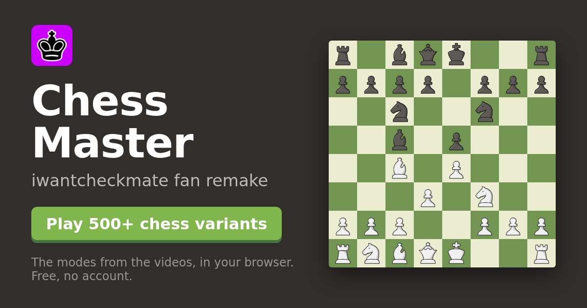
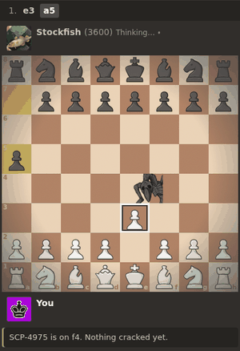
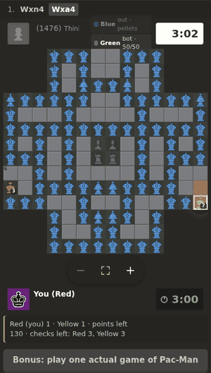
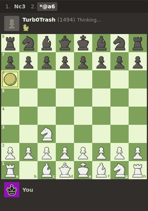
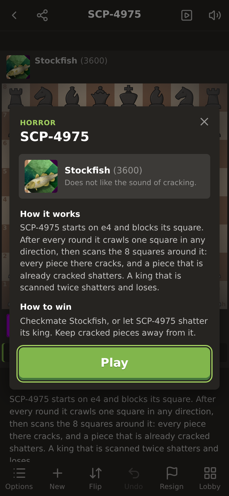
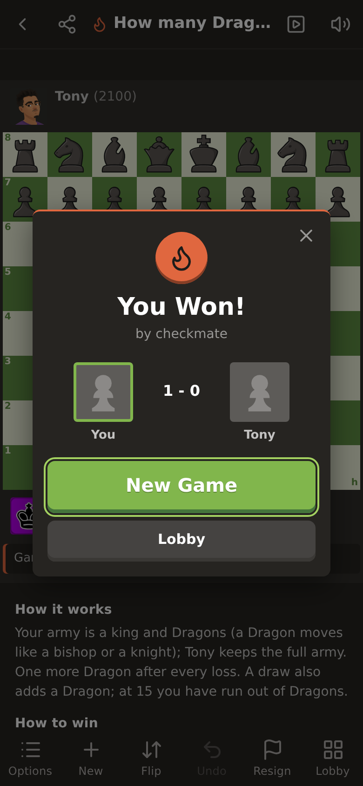

<p align="center">
  <a href="https://csardas223.github.io/ChessMaster/"></a>
</p>

<h1 align="center">Chess Master</h1>

<p align="center"><b>An iwantcheckmate fan remake. Every crazy chess mode from the videos, playable in your browser.</b></p>

<p align="center">
  <a href="https://csardas223.github.io/ChessMaster/"></a>
</p>

<p align="center">
  
  
  
  
  
  
  
  
</p>

---

**Monsters that crack your pieces. A king with a shotgun. Dragons, nukes, ducks, dice, spells and a Pac-Man board.**
Chess Master rebuilds the modes from [iwantcheckmate](https://www.youtube.com/@iwantcheckmate)'s videos and
[iwantcheckmate.com](https://iwantcheckmate.com) one by one: the video's own rules, board, pieces, opponent and
effects, against Stockfish and the bots from the videos. Open the link, pick a mode, play. No install, no account.

<table>
  <tr>
    <td align="center" width="33%"><br><b>SCP-4975</b><br><sub>It crawls, it scans, it cracks your pieces. Kings included.</sub></td>
    <td align="center" width="33%"><br><b>Pac-Man Chess</b><br><sub>A maze board full of pellets. Eat points, survive the checks.</sub></td>
    <td align="center" width="33%"><br><b>Duck Chess</b><br><sub>Move, then drop the duck. Nobody can pass through it.</sub></td>
  </tr>
</table>

## Why you'll keep playing

<table>
  <tr>
    <td width="33%" valign="top"><b>507 modes, one lobby</b><br>Every video's mode in a single phone-sized hub: categories, video types, search, a daily pick, a random roller and your recently played.</td>
    <td width="33%" valign="top"><b>True to the videos</b><br>Custom boards and pieces cut from the videos, monsters and abilities, portals, fog, cards, dice, bonus mini-games, 3D boards and full canvas games.</td>
    <td width="33%" valign="top"><b>Real opponents</b><br>Stockfish 19 by default, Stockfish 17.1 / 10 where a video used them, human-like Maia bots, Fairy-Stockfish for fairy pieces and a variant-aware search for the rest.</td>
  </tr>
  <tr>
    <td valign="top"><b>Horror nights</b><br>SCP and horror modes come with their own cinema: title cards, endings and sound.</td>
    <td valign="top"><b>Every family has its look</b><br>Guns, dragons, nukes, magic, arcade, dice, roguelikes, bot ladders, 4-player: themed title strips, result screens and sounds.</td>
    <td valign="top"><b>Feels like the chess.com app</b><br>Sliding pieces, legal-move dots, clocks, move list, captured pieces, promotion picker, undo, flip, resign, rematch. Touch first.</td>
  </tr>
</table>

## Mode showcase

| | Mode | What happens | Play |
| --- | --- | --- | --- |
|  | **SCP-4975** | A creature roams the board; two scans shatter a piece | [play](https://csardas223.github.io/ChessMaster/play/scp-4975/) |
|  | **Shotgun King** | You are a king with a shotgun against the White Army, floor by floor | [play](https://csardas223.github.io/ChessMaster/play/shotgun-king/) |
|  | **Pac-Man Chess** | A maze board with pellets to eat for points | [play](https://csardas223.github.io/ChessMaster/play/pac-man-chess/) |
|  | **Pawnbarian** | A roguelike: hold piece cards, move your hero like them, clear the monsters | [play](https://csardas223.github.io/ChessMaster/play/pawnbarian/) |
|  | **How many Dragons?** | One more Dragon after every loss until you win | [play](https://csardas223.github.io/ChessMaster/play/how-many-dragons-to-beat-my-chess-bot/) |
|  | **Spell Chess** | Normal chess plus Freeze and other spells | [play](https://csardas223.github.io/ChessMaster/play/spell-chess/) |
|  | **Atomic Chess** | Every capture explodes the squares around it | [play](https://csardas223.github.io/ChessMaster/play/atomic-chess/) |
|  | **Dice Chess** | Three dice decide which piece types move this turn | [play](https://csardas223.github.io/ChessMaster/play/dice-chess/) |
|  | **5D Chess** | Moves across boards and through time | [play](https://csardas223.github.io/ChessMaster/play/5d-chess/) |
|  | **FPS Chess** | Every capture is a first-person duel | [play](https://csardas223.github.io/ChessMaster/play/fps-chess/) |
|  | **Backrooms Chess** | A 30x30 maze; you only see the squares around you | [play](https://csardas223.github.io/ChessMaster/play/backrooms-chess/) |
|  | **Kung Fu Chess** | Real time: no turns, only cooldowns | [play](https://csardas223.github.io/ChessMaster/play/kung-fu-chess/) |

<details>
<summary><b>All categories</b> (counts from <code>data/modes/index.js</code>)</summary>

| Category | Modes |
| --- | ---: |
| Variants & Games | 215 |
| Challenges & Odds | 102 |
| Other Videos | 52 |
| Drawback Chess | 38 |
| Variant Bots | 30 |
| Powerups & Rule Twists | 29 |
| Horror Chess | 23 |
| Dice Chess | 15 |
| Other (Real-time, Meme, Play Stockfish) | 3 |

498 modes run on the shared board engine; 9 are full canvas games. Videos without their own mode yet open in
a ported 8x8 library where one fits.
</details>

<p align="center">
  
  
  
</p>

## System requirements

| | Minimum | Recommended |
| --- | --- | --- |
| **Device** | Any phone, tablet or computer | A phone from the last ~5 years, or any desktop |
| **Browser** | Chrome, Edge, Firefox or Safari with WebAssembly | Latest Chrome / Edge / Firefox / Safari |
| **Network** | Needed on first open of a mode (engines and video thumbnails load from CDNs) | Broadband for the 3D modes |
| **Storage** | None (settings and recent modes stay in your browser) | |
| **Controls** | Touch or mouse | Keyboard + mouse for FPS Chess |

If an engine can't load, the bot falls back to the built-in search and the game stays playable.

## Controls

| Input | Action |
| --- | --- |
| Tap / click a piece, then a highlighted square | Move |
| Drag a piece | Move; slingshot, launch and portal modes read the drag direction and distance |
| Tap a selected piece again | The mode's extra action, where it has one |
| Right-click a square | Mark it (again to clear) |
| Tab, then arrow keys | Keyboard board cursor; Enter / Space selects or moves, Esc leaves the board |
| Action bar | Options, New, Flip, Undo, Resign, Lobby |

Share a mode: the share button in the game bar hands out `https://csardas223.github.io/ChessMaster/play/<slug>/`
(a page with that mode's link preview, e.g. [`play/scp-4975/`](https://csardas223.github.io/ChessMaster/play/scp-4975/));
`#/play/<youtubeId>` links keep working.

---

<details>
<summary><b>For developers</b></summary>

Static site, no build step, no backend. Node.js 20.19+ / 22.13+ / 24+ for the checks only.

```sh
git clone https://github.com/csardas223/ChessMaster.git && cd ChessMaster
npm run serve       # python3 -m http.server 8000, then open http://localhost:8000/
npm ci              # pinned lint/test tooling
npm test            # engine rules tests
npm run lint        # ESLint over js/, qa/, test/, tools/
npm run validate    # every mode file + the generated lobby index
npm run sweep       # builds every mode in a Node sandbox
```

Modes live in `data/modes/<youtubeId>.js` (format: [docs/ARCHITECTURE.md](docs/ARCHITECTURE.md)), their art in
`assets/modes/<youtubeId>/`. Run `node tools/build-data.mjs` after adding or removing a mode (it also writes the
share pages in `play/`). Keep paths relative. Browser checks: `python3 tools/qa_ui.py`, `python3 tools/qa_motion.py`.
README clips: `python3 tools/readme_clips.py`. More: [docs/MODULES.md](docs/MODULES.md), [docs/AI.md](docs/AI.md),
[STATUS.md](STATUS.md), [CONTRIBUTING.md](CONTRIBUTING.md).
</details>

**Credits.** Videos, mode concepts, the iwantcheckmate name, logo and the mode art taken from the videos and the site
belong to [iwantcheckmate](https://www.youtube.com/@iwantcheckmate). Go watch the videos. Engines: Stockfish, Maia,
Fairy-Stockfish (GPLv3). Piece sets via lichess and others, Lucide icons (ISC), three.js (MIT), sounds from CC0
sources. Full list: [LICENSES.md](LICENSES.md).

**Licence.** The project's own code is [Apache-2.0](LICENSE) ([NOTICE](NOTICE)). Third-party assets keep their own
licences, and the Apache licence grants no rights to iwantcheckmate's material. Unofficial, non-commercial fan project.
