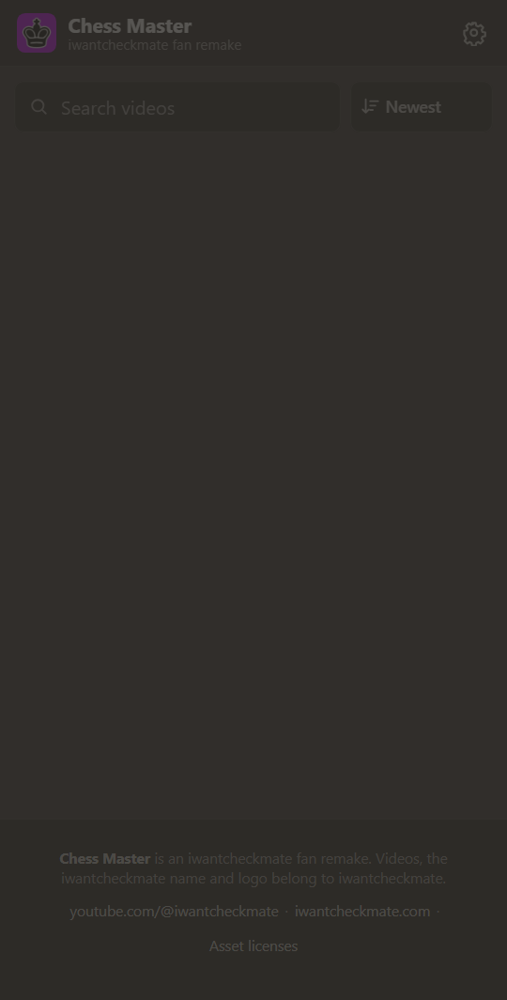
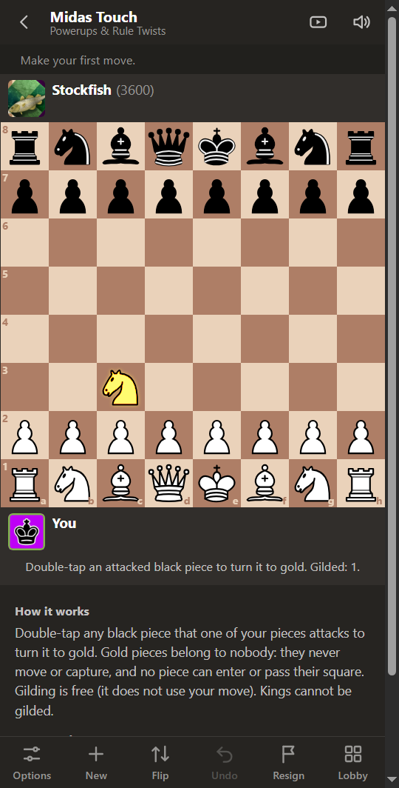
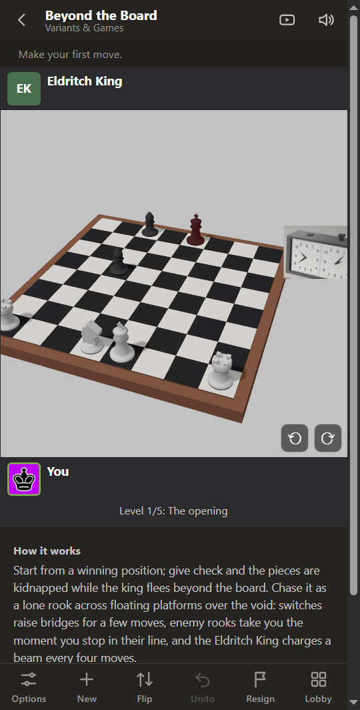

# Chess Master

[](https://github.com/csardas223/ChessMaster/actions/workflows/ci.yml)

A fan remake of [iwantcheckmate](https://www.youtube.com/@iwantcheckmate)'s chess-variant videos: a lobby of all
560 videos, 501 of them remastered as playable modes with the video's own rules, opponents, art and effects, played
against Stockfish and the bots from the videos. It's styled after the chess.com Android app.

All videos, the iwantcheckmate name and logo, and the mode art cut from the videos belong to iwantcheckmate. This is an
unofficial fan project; go watch the videos: [youtube.com/@iwantcheckmate](https://www.youtube.com/@iwantcheckmate) ·
[iwantcheckmate.com](https://iwantcheckmate.com).

## Project status

**Playable and actively developed** (last verified 2026-11-26). All 500 remastered modes build and play against a bot;
the rules tests, lint, mode validation and 500-mode sweep pass in CI. The public demo is **not published yet** — see
[STATUS.md](STATUS.md) for known limitations and next steps.

<p>
  
  
  
</p>

## Features

- **500 playable modes** from the video library, each with its own board, pieces, rules, opponent, sounds and effects;
  the other videos open in a ported 8x8 library where a mode exists.
- **Real opponents:** Stockfish 19 lite by default, plus Stockfish 17.1/10 when a video used them, Maia human-like
  networks (1100–1900), and a built-in search engine for variant positions real engines cannot read.
- **Mode-specific mechanics:** portals, slingshots, monsters, fog, bonus mini-games, 3D boards and full canvas
  games (platformers, shooters), all driven by the same board/engine model.
- **Chess clocks, move list, captured pieces, legal-move dots, last-move/check highlights, board flip, undo and
  resign** in every chess mode.
- **Mouse, touch and keyboard:** click-to-move, drag-and-drop, right-click annotations, double-tap mode actions, and
  an accessible board (see [Controls](#controls)).
- **Responsive, static and dependency-free:** no build step, no backend, no accounts. Works on a plain static host
  (including GitHub Pages) and from `file://` in most browsers.

## Play

**Online demo:** not published yet. The intended URL is https://csardas223.github.io/ChessMaster/, but it returns 404
until GitHub Pages is enabled: repo **Settings → Pages → Build and deployment → Deploy from a branch → `main` /
`/ (root)`**. The site has a `.nojekyll` file, so Pages serves every file as-is, including the `_`-prefixed mode files
that Jekyll would otherwise drop.

**Locally:** this is a plain static website with no build step:

```sh
git clone https://github.com/csardas223/ChessMaster.git
cd ChessMaster
python3 -m http.server 8000      # then open http://localhost:8000/
# or: npx serve .
```

Opening `index.html` straight from disk (`file://`) works in most browsers too: every script is a classic script and
the data ships as `.js` files. Some browsers lock down `file://` more than others, so use a server if something looks
off.

Network access you'll need: Stockfish WASM loads from unpkg.com the first time a mode uses it, Maia weights load from
jsDelivr/GitHub, and lobby thumbnails come from YouTube (i.ytimg.com). Everything else is in the repo. If an engine
cannot load, the bot falls back to the built-in search engine and the game stays playable.

## Controls

| Input | Action |
| --- | --- |
| Click / tap a piece, then a highlighted square | Move (or select; tap the same square again for a mode's extra action) |
| Drag a piece | Move; some modes read the drag direction and distance (slingshot, launch, portals) |
| Right-click a square | Mark it; a second right-click clears the mark |
| Double right-click a square | Mode-specific extra gesture where one exists |
| **Tab** | Enter the board (one tab stop) |
| **Arrow keys** | Move the board cursor, skipping holes |
| **Home / End** | First / last square in the row |
| **Ctrl+Home / Ctrl+End** | First / last square on the board |
| **Enter / Space** | Select the focused square or move to it |
| **Esc** | Leave the board |
| Action bar | Options, New, Flip, Undo, Resign, Lobby |
| Mode panel | Mode-specific buttons, cards, hands and level pickers |

The board is exposed as a `role="grid"` with named squares and selected/legal-move/check states, and the status line is
an `aria-live` region. Menus, dialogs and settings are regular buttons and links, so they work with keyboard and screen
readers. The layout is responsive down to phone widths; the board sizes itself to the visible area and keeps its
squares square.

## Documentation

- [STATUS.md](STATUS.md) — what works, known limitations, verification commands and possible next steps.
- [docs/ARCHITECTURE.md](docs/ARCHITECTURE.md) — app structure and the full mode-file format.
- [docs/AI.md](docs/AI.md) — opponents, engine selection, fallbacks and bot styles.
- [docs/MODULES.md](docs/MODULES.md) — game/board/rules/UI boundaries and load order.
- [CONTRIBUTING.md](CONTRIBUTING.md) — setup, PR checklist and mode/art rules.
- [LICENSES.md](LICENSES.md) — third-party assets and their licenses.

## Development

Requirements: Python 3 (or any static server) to play, and Node.js 20.19+, 22.13+ or 24+ for the checks and tooling.

```sh
npm ci             # installs the pinned lint/test tooling only (the site itself has no dependencies)
npm test           # engine rules tests: legality, check, mate, stalemate, castling, en passant, promotion
npm run lint       # ESLint over the hand-written scripts and tooling
npm run validate   # checks every mode file and the generated lobby data
npm run sweep      # builds all 500 modes in a Node sandbox and reports engine warnings
npm run ci         # all of the above, the same commands CI runs
```

CI (`.github/workflows/ci.yml`) runs lint, tests, mode validation and the engine sweep on every push to `main` and on
pull requests. The test harness loads the real browser engine scripts in a VM (`test/engine-sandbox.mjs`), so it tests
the same code the site runs.

- Add or edit a mode in `data/modes/<videoId>.js` (format in [docs/ARCHITECTURE.md](docs/ARCHITECTURE.md)), put its
  art in `assets/modes/<videoId>/`, then run `node tools/build-data.mjs` so the lobby index picks it up
  (`node tools/build-data.mjs --check` validates every mode file).
- Keep every path relative (`assets/...`, never `/assets/...`). The site has to work at a domain root and under the
  `/ChessMaster/` Pages subpath, and Pages is case-sensitive.
- Pin runtime CDN versions when adding one; the existing Stockfish/Maia URLs are versioned and listed in
  [LICENSES.md](LICENSES.md). Project tooling is pinned exactly in `package.json` / `package-lock.json`.
- UI check (optional, needs Playwright): `pip install playwright && python -m playwright install --with-deps chromium`,
  then `python3 tools/qa_ui.py`.
- The research behind the rebuild (video transcripts, frame notes, per-mode specs, art-cutting scripts and the full QA
  harness) lives on the `rebuild` branch under `rebuild/`. It isn't needed to run or host the site.

See [CONTRIBUTING.md](CONTRIBUTING.md) for the PR checklist and [docs/MODULES.md](docs/MODULES.md) for where each part
of the app lives.

## How the opponents work

There is **no online multiplayer** and there are no accounts: every game is single-player against a bot.

`CM.bot.engineFor` picks an engine per position. Standard 8x8 positions with no rule hooks use real Stockfish
(UCI_Elo when the opponent is rated below 3190) or Maia for human-like opponents; modes pinned to a specific engine in
`data/bot_engines.js` get that build. Everything else (custom boards, portals, monsters, hands) uses the built-in
`CM.Search`, which understands the variant rules. If a network engine fails or is unavailable, the bot falls back to
Stockfish when legal, then to `CM.Search`; nothing loads until a bot needs it. Full details, including Elo-to-engine
mapping, Maia temperature and mode-level overrides, are in [docs/AI.md](docs/AI.md) and
[ARCHITECTURE.md §8](docs/ARCHITECTURE.md#8-bot-and-opponent).

## Layout

```
index.html        lobby + game screens, boot-failure guard
css/              styles (chess.com look), responsive layout, board focus rings
js/core           namespace, settings, sound
js/engine         geometry, movement, variants, search, mode spec, events
js/ui             board view, game chrome, settings panel  (board = js/ui/board-view.js)
js/game           SpecGame (data-driven chess modes) and GameFrame (canvas games)
js/bot            Stockfish, Maia, engine choice and bot styles
js/fx             VFX and the three.js scene
js/lobby          video library UI
js/modes          mode-specific hooks (500 modes)
js/games          canvas game modules
js/legacy         ported 8x8 mode library
data/             videos.js + mode files + generated lobby index
assets/           pieces, boards, sounds, avatars, assets/modes/<videoId>/
test/             Node rules tests and the engine sandbox
qa/               engine sweep, mode validator, lab page, screenshots
tools/            build-data.mjs, qa_ui.py
docs/             architecture, AI, module map
```

## Credits

- Videos, mode concepts and mode art: [iwantcheckmate](https://www.youtube.com/@iwantcheckmate).
- Engine: [Stockfish](https://stockfishchess.org/) (GPLv3), loaded at runtime from unpkg, not bundled.
- Maia weights: [CSSLab/maia-chess](https://github.com/CSSLab/maia-chess) (GPLv3), loaded at runtime.
- Piece sets, board sounds and three.js: see [LICENSES.md](LICENSES.md).

## License

The **code** in this repository is released under the [MIT License](LICENSE). Bundled third-party assets keep their
own licenses (GPL/Apache/MIT/AGPL as listed in [LICENSES.md](LICENSES.md)), and the videos, iwantcheckmate name/logo and
mode art remain the property of iwantcheckmate. The MIT license does not grant rights to those assets.

> Next AI: read [HANDOFF.md](HANDOFF.md) first.
