<p align="center">
  <a href="https://csardas223.github.io/ChessMaster/">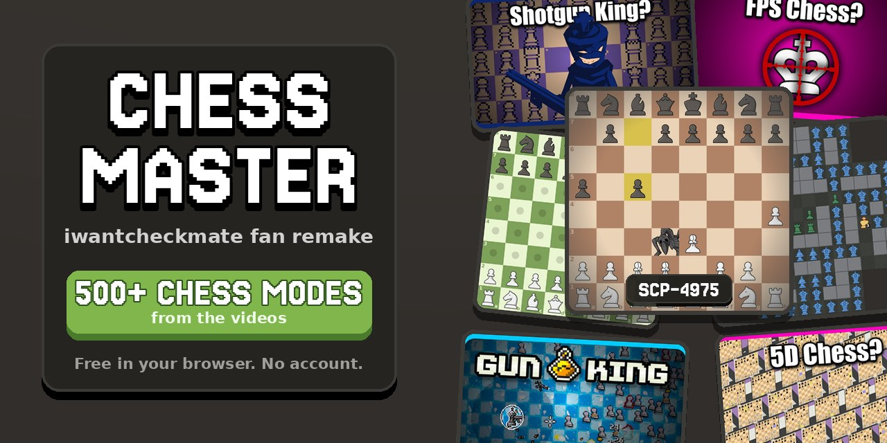</a>
</p>

<h3 align="center">A king with a shotgun. A monster that cracks your pieces. A duck nobody can pass.<br>500+ chess modes from iwantcheckmate's videos, free in your browser.</h3>

<p align="center">
  <a href="https://csardas223.github.io/ChessMaster/"></a>
</p>

<p align="center">
  
</p>


<p align="center">
  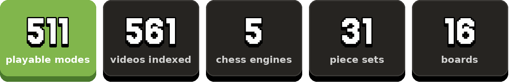
</p>

<p align="center"><sub>Counted from the repo: one <code>play/&lt;slug&gt;/</code> page per mode; Stockfish 10, 17 and 19, Maia and Fairy-Stockfish.</sub></p>


<p align="center">
  <a href="https://csardas223.github.io/ChessMaster/play/scp-4975/">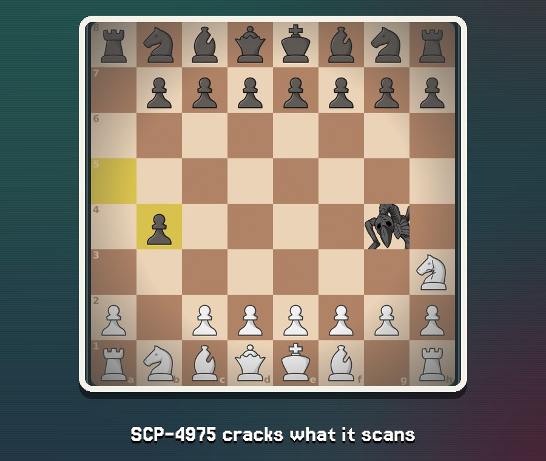</a>
  <a href="https://csardas223.github.io/ChessMaster/play/spell-chess/">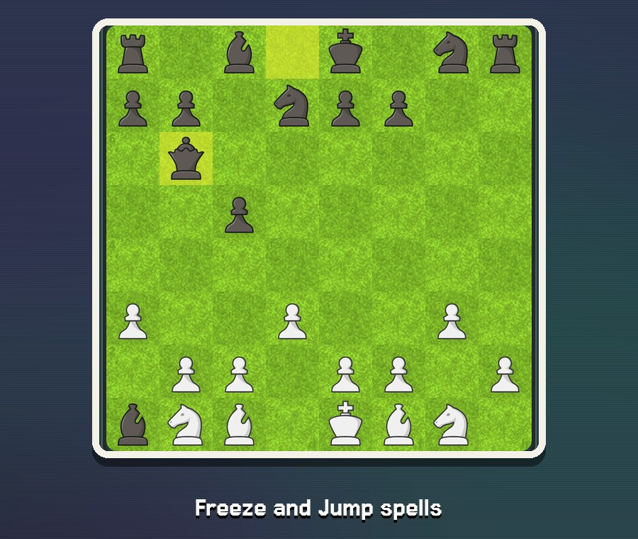</a>
</p>

<p align="center">
  <a href="https://csardas223.github.io/ChessMaster/play/shotgun-king/">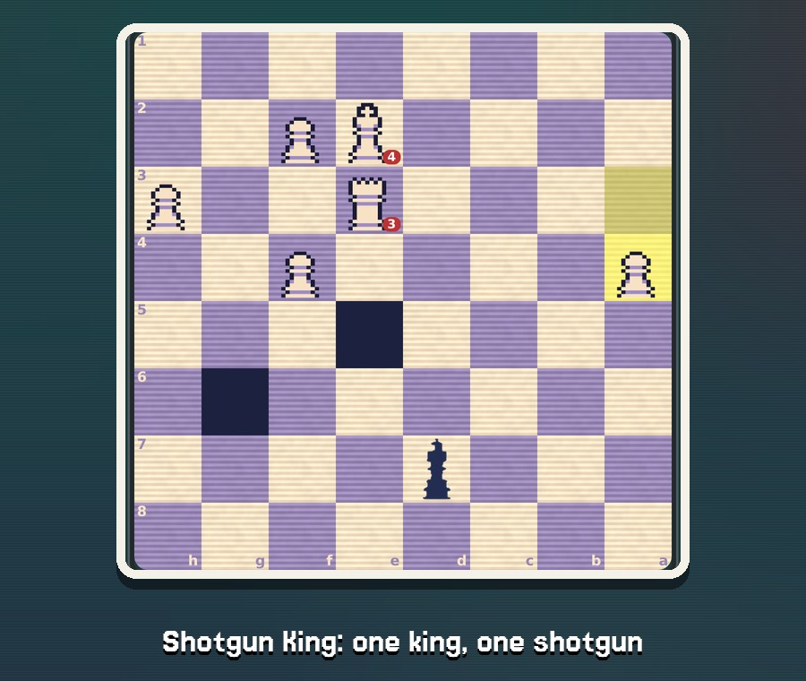</a>
  <a href="https://csardas223.github.io/ChessMaster/play/soko-chess/">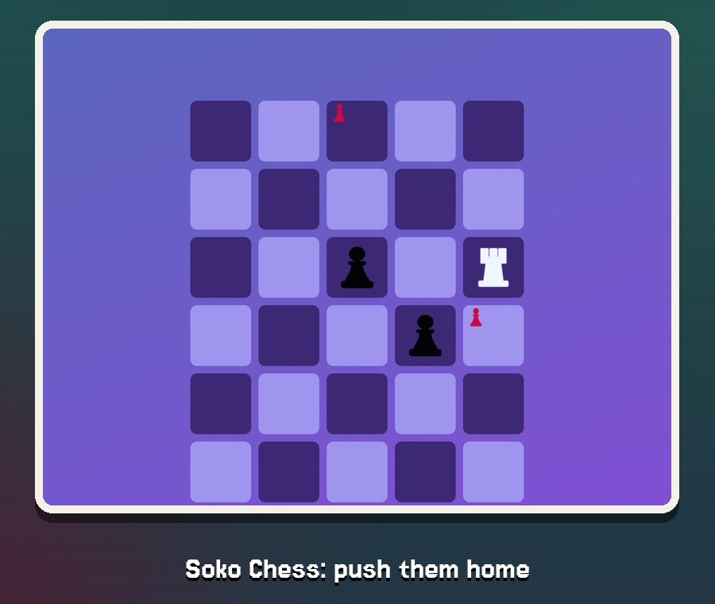</a>
</p>

<p align="center">
  <a href="https://csardas223.github.io/ChessMaster/play/pac-man-chess/">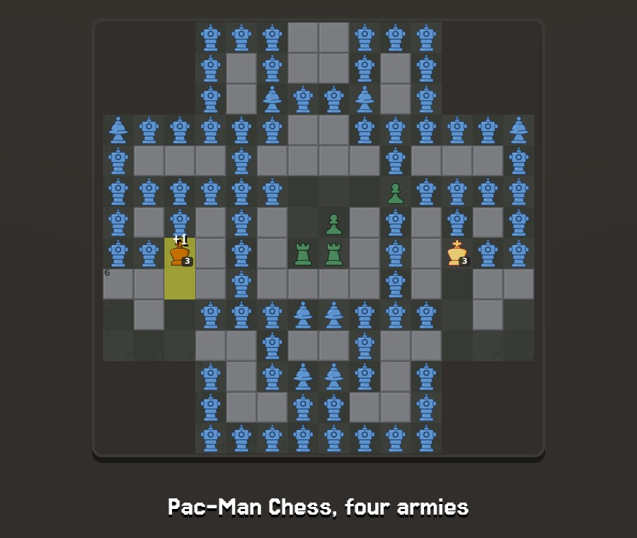</a>
  <a href="https://csardas223.github.io/ChessMaster/play/duck-chess/">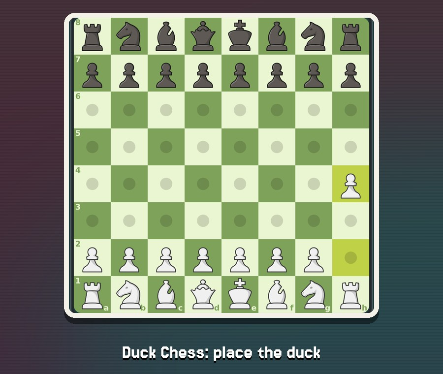</a>
</p>

<p align="center"><sub>Real screenshots from the game, taken in headless Chromium.</sub></p>

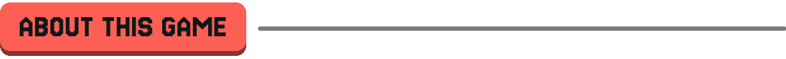

Chess Master rebuilds the modes from [iwantcheckmate](https://www.youtube.com/@iwantcheckmate)'s videos and
[iwantcheckmate.com](https://iwantcheckmate.com) one by one: the video's own rules, board, pieces, opponent and
effects, against Stockfish and the bots from the videos. Open the link, pick a mode, play. It runs on a phone first
and plays just as well with a mouse.

- **500+ modes, one lobby.** Categories, video types, search, a daily pick, a random roller and your recently played.
- **True to the videos.** Their rules, boards, pieces, bots and effects; horror modes get full title cards and endings.
- **Plays like chess.com.** Sliding pieces, legal-move dots, clocks, move list, promotion picker, undo, flip, rematch,
  and right-drag arrows with a mouse.
- **Whole games inside.** Roguelikes, a platformer, Gun King, 5D chess, FPS duels and 3D Battle Chess.
- **Real engines.** Stockfish (the exact versions the videos used), human-like Maia bots and Fairy-Stockfish.
- **Share any mode.** Every mode has its own link with a preview card, like [`play/scp-4975/`](https://csardas223.github.io/ChessMaster/play/scp-4975/).


<p align="center">
  <a href="https://csardas223.github.io/ChessMaster/">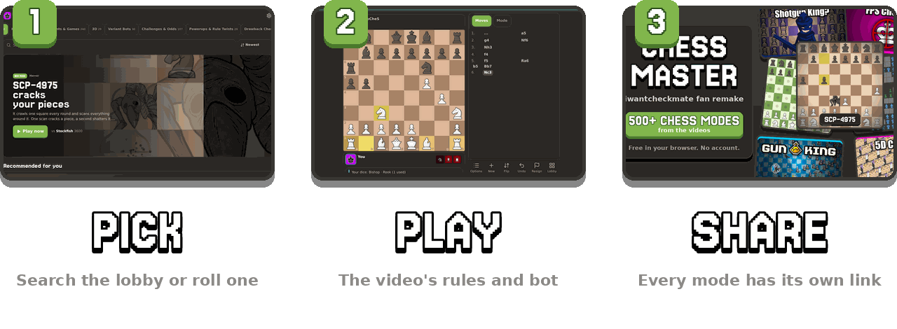</a>
</p>


<p align="center">
  <a href="https://csardas223.github.io/ChessMaster/play/scp-4975/">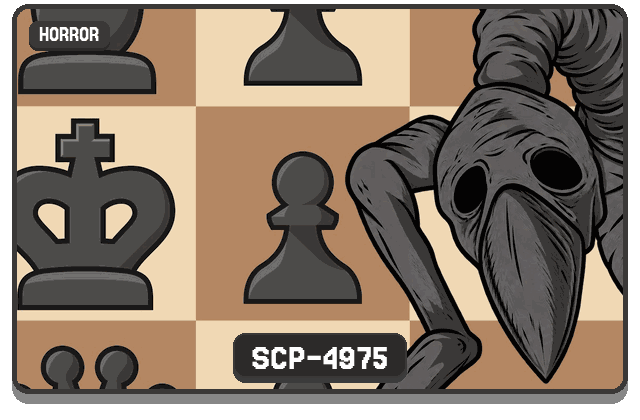</a>
  <a href="https://csardas223.github.io/ChessMaster/play/scp-096-shy-guy/">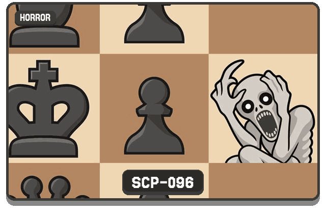</a>
  <a href="https://csardas223.github.io/ChessMaster/play/backrooms-chess/">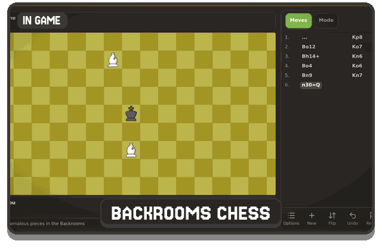</a>
</p>


<p align="center">
  <a href="https://csardas223.github.io/ChessMaster/play/shotgun-king/">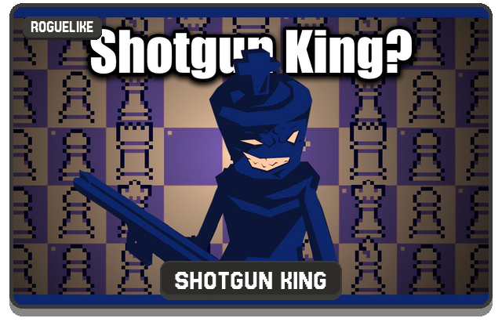</a>
  <a href="https://csardas223.github.io/ChessMaster/play/once-a-pawn-a-king/">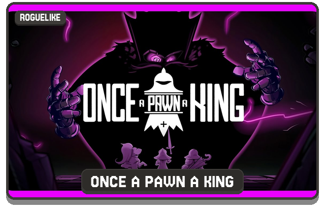</a>
  <a href="https://csardas223.github.io/ChessMaster/play/gambonanza/">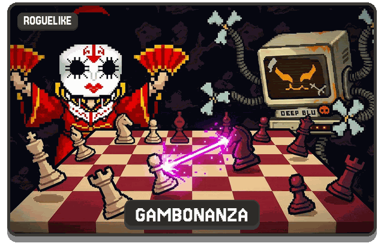</a>
</p>


<p align="center">
  <a href="https://csardas223.github.io/ChessMaster/play/fps-chess/">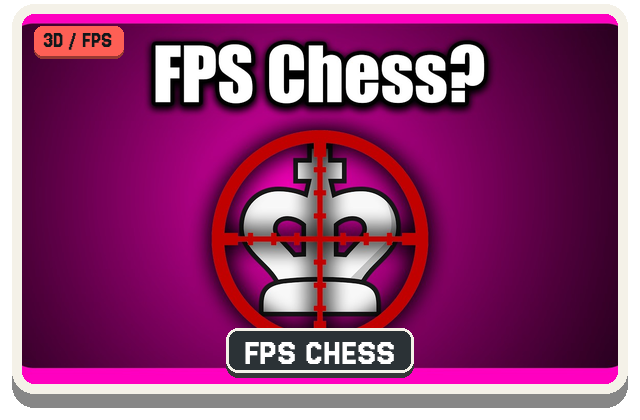</a>
  <a href="https://csardas223.github.io/ChessMaster/play/battle-chess/">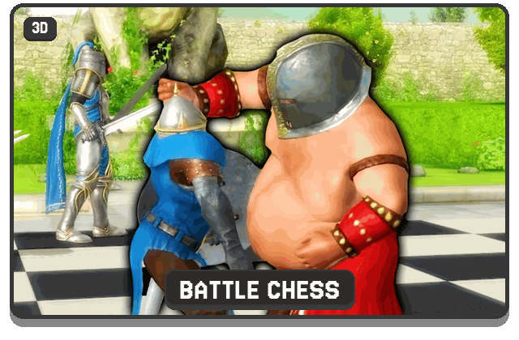</a>
  <a href="https://csardas223.github.io/ChessMaster/play/gun-king/">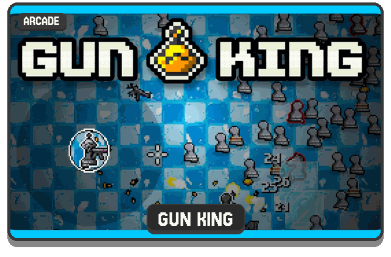</a>
  <a href="https://csardas223.github.io/ChessMaster/play/chess-survivors/">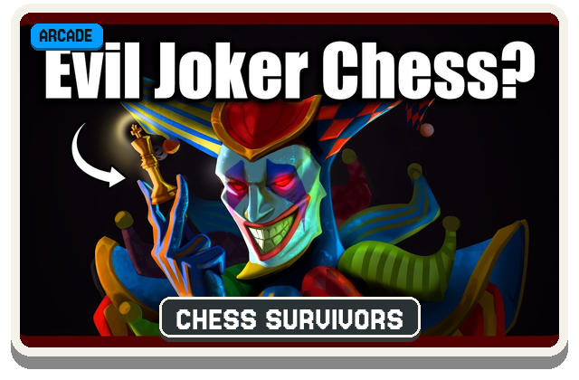</a>
  <a href="https://csardas223.github.io/ChessMaster/play/chess-arena-battle-royale/">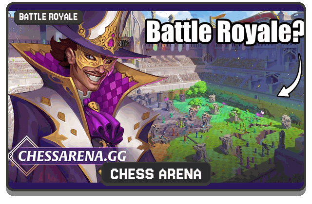</a>
  <a href="https://csardas223.github.io/ChessMaster/play/kung-fu-chess/">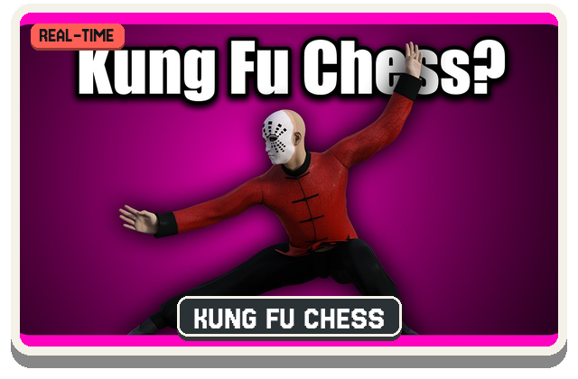</a>
</p>


<p align="center">
  <a href="https://csardas223.github.io/ChessMaster/play/4-player-team-chess/">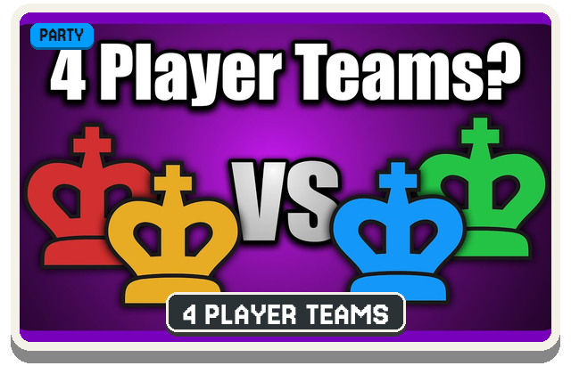</a>
  <a href="https://csardas223.github.io/ChessMaster/play/chaturaji-4-player/">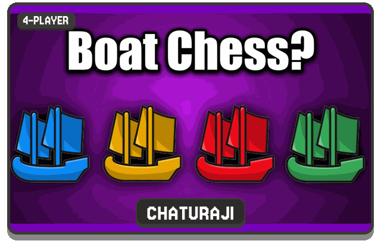</a>
  <a href="https://csardas223.github.io/ChessMaster/play/4-player-chess/">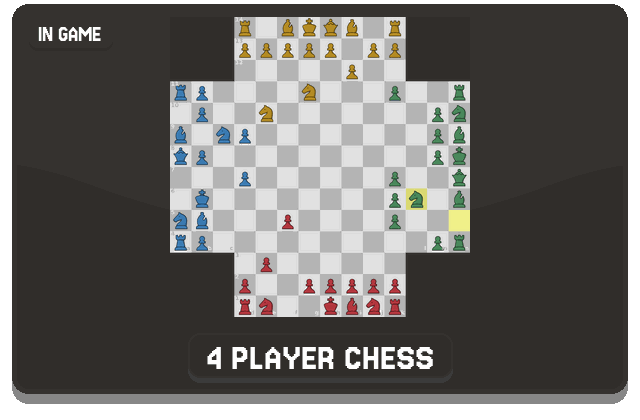</a>
</p>


<p align="center">
  <a href="https://csardas223.github.io/ChessMaster/play/soko-chess/">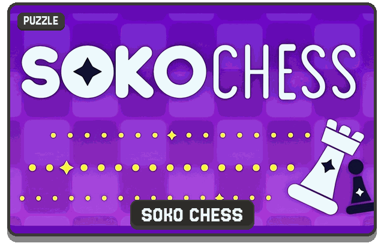</a>
  <a href="https://csardas223.github.io/ChessMaster/play/beyond-the-board/">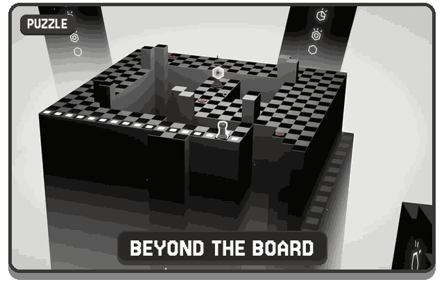</a>
  <a href="https://csardas223.github.io/ChessMaster/play/chessformer/">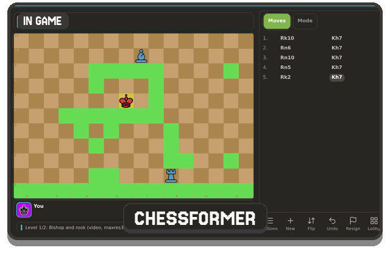</a>
</p>


<p align="center">
  <a href="https://csardas223.github.io/ChessMaster/play/5d-chess/">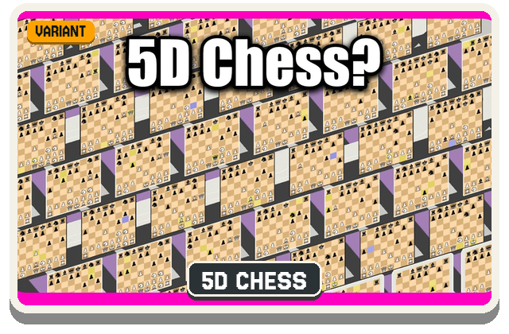</a>
  <a href="https://csardas223.github.io/ChessMaster/play/portal-chess/">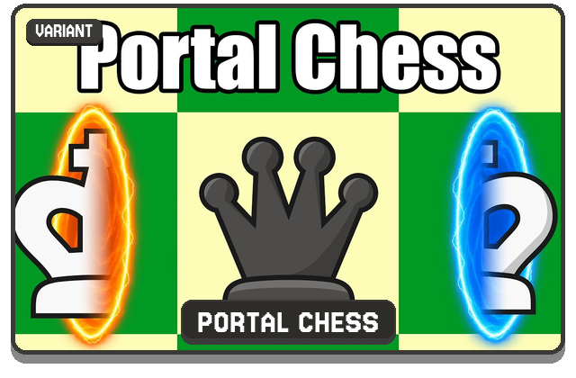</a>
  <a href="https://csardas223.github.io/ChessMaster/play/petrified-pawns/">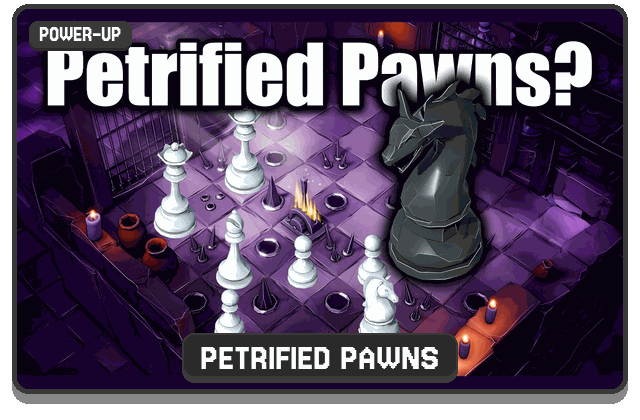</a>
  <a href="https://csardas223.github.io/ChessMaster/play/atomic-chess/">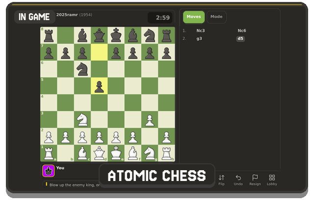</a>
  <a href="https://csardas223.github.io/ChessMaster/play/dice-chess/">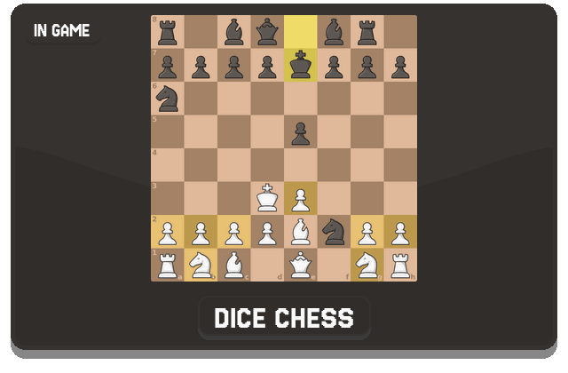</a>
  <a href="https://csardas223.github.io/ChessMaster/play/duck-chess/">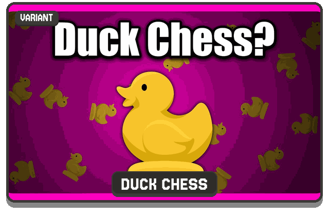</a>
</p>
<p align="center"><b><a href="https://csardas223.github.io/ChessMaster/">Browse all 500+ modes in the lobby</a></b></p>


<table>
  <tr><th align="left">&nbsp;</th><th align="left">Minimum</th><th align="left">Recommended</th></tr>
  <tr><td><b>Device</b></td><td>Any phone, tablet or computer</td><td>A phone from the last ~5 years, or any desktop</td></tr>
  <tr><td><b>Browser</b></td><td>Chrome, Edge, Firefox or Safari with WebAssembly</td><td>Latest Chrome, Edge, Firefox or Safari</td></tr>
  <tr><td><b>Graphics</b></td><td>Any (2D modes)</td><td>WebGL for the 3D and FPS modes</td></tr>
  <tr><td><b>Network</b></td><td>Online on first open of a mode</td><td>Broadband for the 3D modes</td></tr>
  <tr><td><b>Storage</b></td><td>None, nothing to install</td><td>None</td></tr>
  <tr><td><b>Input</b></td><td>Touch or mouse</td><td>Keyboard + mouse for FPS Chess</td></tr>
</table>

If an engine can't load, the bot falls back to the built-in search and the game stays playable.

---

<details>
<summary><b>Controls</b></summary>

| Input | Action |
| --- | --- |
| Tap / click a piece, then a highlighted square | Move |
| Drag a piece | Move; slingshot, launch and portal modes read the drag direction and distance |
| Tap a selected piece again | The mode's extra action, where it has one |
| Right-click a square | Mark it (again to clear) |
| Tab, then arrow keys | Keyboard board cursor; Enter / Space selects or moves, Esc leaves the board |
| Action bar | Options, New, Flip, Undo, Resign, Lobby |
</details>

<details>
<summary><b>For developers</b></summary>

Static site, no build step, no backend. Node.js 20.19+ / 22.13+ / 24+ for the checks only.

```sh
git clone https://github.com/csardas223/ChessMaster.git && cd ChessMaster
npm run serve       # python3 -m http.server 8000, then open http://localhost:8000/
npm ci              # pinned lint/test tooling
npm test            # engine rules tests
npm run lint        # ESLint over js/, qa/, test/, tools/
npm run validate    # every mode file + the generated lobby index
npm run sweep       # builds every mode in a Node sandbox
```

Modes live in `data/modes/<youtubeId>.js` (format: [docs/ARCHITECTURE.md](docs/ARCHITECTURE.md)), their art in
`assets/modes/<youtubeId>/`. Run `node tools/build-data.mjs` after adding or removing a mode (it also writes the
share pages in `play/`). Browser checks: `python3 tools/qa_ui.py`, `python3 tools/qa_motion.py`.
README media (`docs/media/`, all static): `python3 tools/readme_store.py --capture` (screenshots, button, tags, headers),
then `python3 tools/readme_long.py --capture` (hero banner, numbers band, how-it-works strip, theme shelves, mode cards). More: [docs/MODULES.md](docs/MODULES.md),
[docs/AI.md](docs/AI.md), [STATUS.md](STATUS.md), [CONTRIBUTING.md](CONTRIBUTING.md), [HANDOFF.md](HANDOFF.md).
</details>

<sub><b>Credits.</b> Videos, mode concepts, the iwantcheckmate name and logo, and the mode art and thumbnails taken
from the videos and the site belong to <a href="https://www.youtube.com/@iwantcheckmate">iwantcheckmate</a>. Go watch
the videos. Engines: Stockfish, Maia, Fairy-Stockfish (GPLv3). Piece sets via lichess and others, Lucide icons (ISC),
three.js (MIT), sounds from CC0 sources and our own synthesis. Full list: <a href="LICENSES.md">LICENSES.md</a>.<br>
<b>Licence.</b> The project's own code is <a href="LICENSE">Apache-2.0</a> (<a href="NOTICE">NOTICE</a>). Third-party
assets keep their own licences, and the Apache licence grants no rights to iwantcheckmate's material. Unofficial,
non-commercial fan project.</sub>

<p align="center"><a href="https://www.youtube.com/@iwantcheckmate"></a><br><sub>Made with love for <a href="https://www.youtube.com/@iwantcheckmate">iwantcheckmate</a>. Watch the videos.</sub></p>
