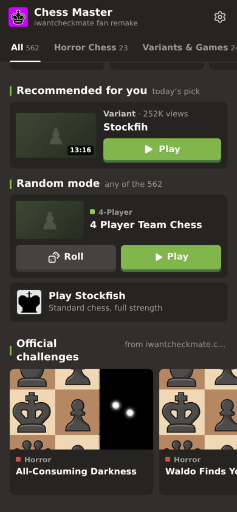
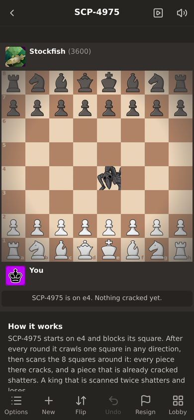
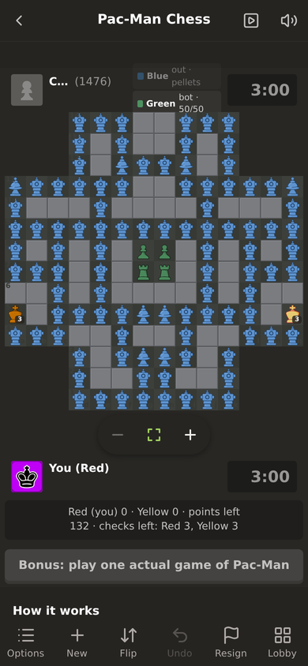
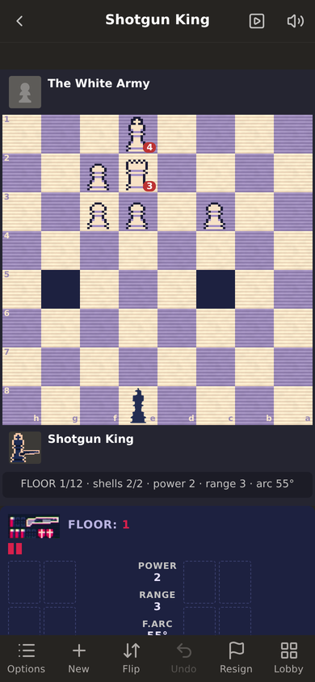

# Chess Master

**An iwantcheckmate fan remake: 503 playable chess variants from the videos, in your browser.**

[](https://github.com/csardas223/ChessMaster/actions/workflows/ci.yml)
[](https://csardas223.github.io/ChessMaster/)
[](LICENSE)
-lightgrey)

<p align="center">
  
  
  
  
</p>

Chess Master recreates the modes from [iwantcheckmate](https://www.youtube.com/@iwantcheckmate)'s videos and
[iwantcheckmate.com](https://iwantcheckmate.com): each with the video's own rules, board, opponent and effects, played
against Stockfish and the bots from the videos. The look follows the chess.com Android app. It is an unofficial,
non-commercial fan project.

## Features

- **503 playable modes** in a lobby of all 561 videos, with category tabs, search, sorting and a random pick.
- **Faithful to the videos:** custom boards and pieces, monsters and abilities, portals, fog, cards, dice, bonus
  mini-games, 3D boards and full canvas games.
- **Real opponents:** Stockfish 19 lite by default, Stockfish 17.1 / 10 where a video used them, Maia human-like
  networks (1100-1900), a bundled Fairy-Stockfish for fairy variants, and a built-in variant-aware search for
  positions no engine can read.
- **Full game chrome:** clocks, move list, captured pieces, legal-move dots, promotion picker, undo, flip, resign,
  rematch.
- **Phone first:** touch and drag, sliding piece motion, responsive down to small phones; reduced-motion respected.
- **Static and dependency-free:** no build step, no backend, no accounts.

## Play

**Online:** <https://csardas223.github.io/ChessMaster/> (GitHub Pages, served from `main`). A direct link to a mode
is `#/play/<youtubeId>`, for example
[`#/play/HuZlhHnES7M`](https://csardas223.github.io/ChessMaster/#/play/HuZlhHnES7M) for SCP-4975.

**Locally:**

```sh
git clone https://github.com/csardas223/ChessMaster.git
cd ChessMaster
npm run serve        # = python3 -m http.server 8000, then open http://localhost:8000/
```

Stockfish (unpkg), Maia weights (jsDelivr) and lobby thumbnails (YouTube) load from the network on first use. If an
engine can't load, the bot falls back to the built-in search and the game stays playable.

## Controls

| Input | Action |
| --- | --- |
| Tap / click a piece, then a highlighted square | Move |
| Drag a piece | Move; slingshot, launch and portal modes read the drag direction and distance |
| Tap a selected piece again | The mode's extra action, where it has one |
| Right-click a square | Mark it (again to clear) |
| Tab, then arrow keys | Keyboard board cursor; Enter / Space selects or moves, Esc leaves the board |
| Action bar | Options, New, Flip, Undo, Resign, Lobby |
| Mode panel | Mode-specific buttons, cards, hands and level pickers |

The board is an accessible `role="grid"` with named squares, and the status line is an `aria-live` region.

## Mode library

Counts from `data/modes/index.js` (503 modes):

| Category | Modes |
| --- | ---: |
| Variants & Games | 211 |
| Challenges & Odds | 102 |
| Other Videos | 52 |
| Drawback Chess | 38 |
| Variant Bots | 30 |
| Powerups & Rule Twists | 29 |
| Horror Chess | 23 |
| Dice Chess | 15 |
| Other (Real-time, Meme, Play Stockfish) | 3 |

495 modes run on the shared board engine; 8 are full canvas games. Videos without their own mode open in a ported
8x8 library where one fits.

## Development

Requirements: any static server to play; Node.js 20.19+, 22.13+ or 24+ for the checks.

```sh
npm ci              # pinned lint/test tooling only; the site loads nothing from node_modules
npm test            # engine rules tests (legality, check, mate, castling, en passant, promotion)
npm run lint        # ESLint over js/, qa/, test/, tools/
npm run validate    # node tools/build-data.mjs --check: every mode file + the generated lobby index
npm run sweep       # builds all 503 modes in a Node sandbox and reports engine warnings
npm run ci          # all of the above, as GitHub Actions runs them on every push and PR
```

- Modes live in `data/modes/<youtubeId>.js` (format in [docs/ARCHITECTURE.md](docs/ARCHITECTURE.md)), their art
  in `assets/modes/<youtubeId>/`. Run `node tools/build-data.mjs` after adding or removing a mode.
- Keep paths relative (`assets/...`): the site must work at a domain root and under `/ChessMaster/`.
- Optional browser checks (Playwright + Chromium): `python3 tools/qa_ui.py`, `python3 tools/qa_motion.py`.

## Project structure

```
index.html      lobby + game screens
css/            chess.com-style UI, board, effects
js/core/        namespace, settings, sound
js/engine/      geometry, move generation, variants, search, mode spec
js/ui/          board view, game chrome, settings, icons
js/game/        SpecGame (data-driven chess modes) and GameFrame (canvas games)
js/bot/         Stockfish, Maia, Fairy-Stockfish, engine choice, bot styles
js/fx/          VFX, cinematics, three.js scenes
js/lobby/       video library
js/modes/       mode-specific hooks
js/games/       canvas game modules
data/           videos, mode files, generated lobby index
assets/         pieces, boards, sounds, avatars, per-mode art
test/  qa/      rules tests, engine sweep, mode validator
tools/          data build, art/sound generators, QA scripts
docs/           architecture, AI, module map
research/       video specs, frame notes and reference sprites behind the modes (not needed to run the site)
```

More detail: [docs/ARCHITECTURE.md](docs/ARCHITECTURE.md), [docs/AI.md](docs/AI.md),
[docs/MODULES.md](docs/MODULES.md), [STATUS.md](STATUS.md).

## Credits & licences

- **iwantcheckmate** ([YouTube](https://www.youtube.com/@iwantcheckmate), [iwantcheckmate.com](https://iwantcheckmate.com)):
  the videos, mode concepts, name, logo and the mode art taken from the videos and the site all belong to
  iwantcheckmate. Go watch the videos.
- **Piece sets** (`assets/pieces/`): Staunty by sadsnake1 via lichess (default, CC BY-NC-SA 4.0); cburnett and Merida
  (GPLv2+, via lichess); MPChess (GPLv3+, via lichess); Chessnut (Apache-2.0); Fantasy, Celtic and Spatial by Maurizio
  Monge (MIT).
- **Engines:** [Stockfish](https://stockfishchess.org/) (GPLv3, loaded at runtime),
  [Maia](https://github.com/CSSLab/maia-chess) weights (GPLv3, loaded at runtime),
  [Fairy-Stockfish](https://github.com/fairy-stockfish/Fairy-Stockfish) (GPLv3, bundled WebAssembly build).
- **Libraries:** three.js (MIT), Lucide icons (ISC).
- **Sounds:** made for this project from CC0 recordings (Kenney, VCSL, VSCO 2 CE, Freesound CC0 uploads) and
  synthesis; sources in `tools/sfx/sources.md`.

Full list with sources: [LICENSES.md](LICENSES.md). The **code** is [Apache 2.0](LICENSE) (see [NOTICE](NOTICE)); bundled third-party assets keep
their own licences, and the Apache licence grants no rights to iwantcheckmate's material.

## Contributing

Bug reports and fixes to mode rules, the engine, UI and accessibility are welcome. See
[CONTRIBUTING.md](CONTRIBUTING.md) for setup and the PR checklist.
