<p align="center">
  <a href="https://csardas223.github.io/ChessMaster/">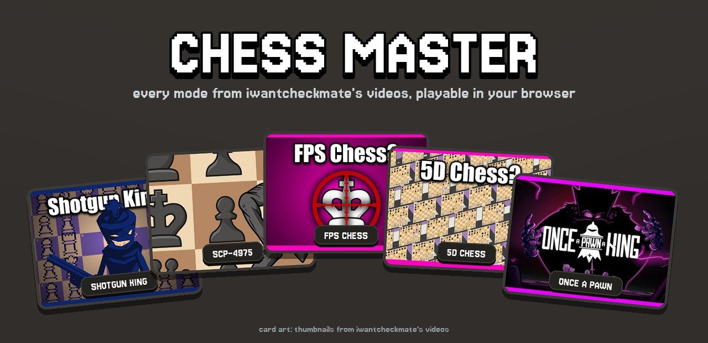</a>
</p>

<h3 align="center">A king with a shotgun. A monster that cracks your pieces. A duck nobody can pass.<br>Every crazy chess mode from iwantcheckmate's videos, playable in your browser.</h3>

<p align="center">
  <a href="https://csardas223.github.io/ChessMaster/"></a>
</p>

<p align="center">
  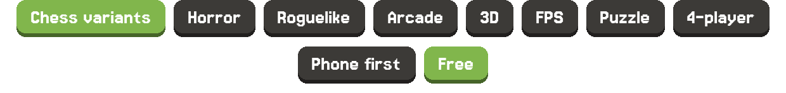
</p>

## Gameplay

<p align="center"><sub>Recorded in headless Chromium from the real game. Board modes at 390x844 (phone), FPS Chess at 960x540, Battle Chess from the 390x844 3D QA run.</sub></p>

<p align="center">
  <a href="https://csardas223.github.io/ChessMaster/play/scp-4975/">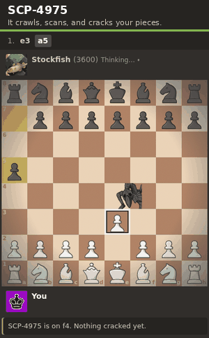</a>
  <a href="https://csardas223.github.io/ChessMaster/play/spell-chess/">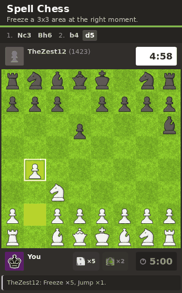</a>
</p>
<p align="center">
  <a href="https://csardas223.github.io/ChessMaster/play/fps-chess/">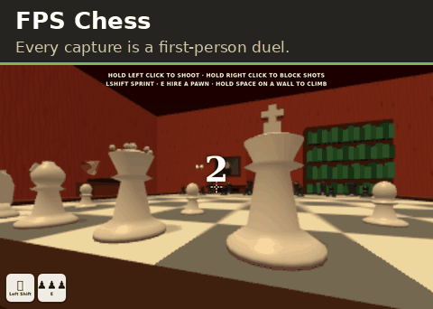</a>
</p>
<p align="center">
  <a href="https://csardas223.github.io/ChessMaster/play/duck-chess/">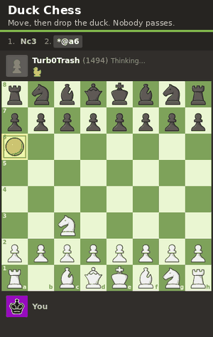</a>
  <a href="https://csardas223.github.io/ChessMaster/play/pac-man-chess/">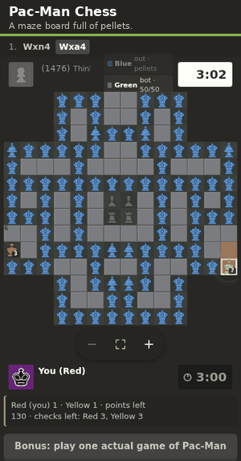</a>
</p>
<p align="center">
  <a href="https://csardas223.github.io/ChessMaster/play/battle-chess/">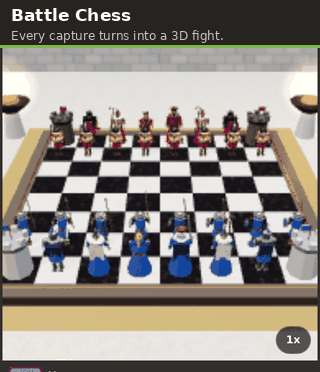</a>
</p>

## About this game

Chess Master rebuilds the modes from [iwantcheckmate](https://www.youtube.com/@iwantcheckmate)'s videos and
[iwantcheckmate.com](https://iwantcheckmate.com) one by one: the video's own rules, board, pieces, opponent and
effects, against Stockfish and the bots from the videos. Open the link, pick a mode, play. It runs on a phone first
and plays just as well with a mouse.

<p align="center">
  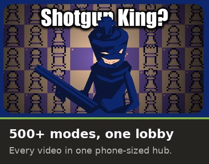
  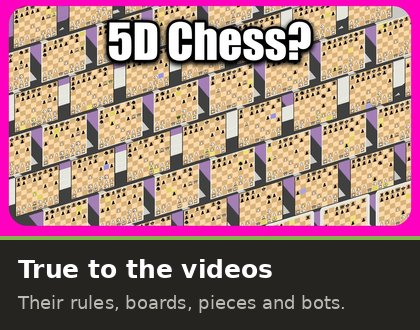
  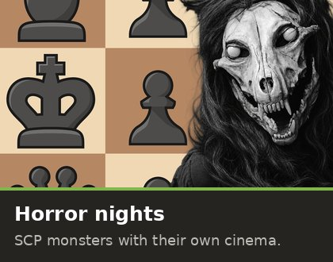
  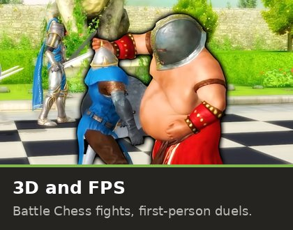
  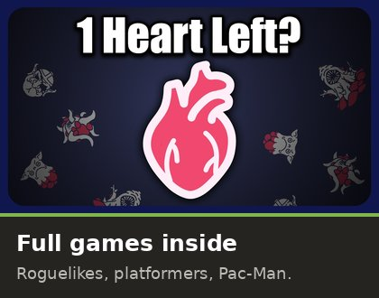
  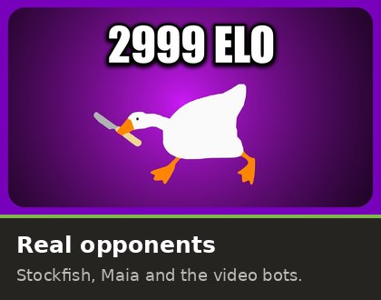
</p>

- **One lobby for 500+ modes.** Categories, video types, search, a daily pick, a random roller and your recently played.
- **Every family has its own look.** Guns, dragons, nukes, magic, arcade, dice, roguelikes, bot ladders and 4-player
  get themed title strips, result screens and sounds; the horror modes get full title cards and endings.
- **Plays like the chess.com app.** Sliding pieces, legal-move dots, clocks, move list, promotion picker, undo,
  flip, rematch. Touch first, keyboard and mouse supported.
- **Real engines.** Stockfish by default, the exact Stockfish versions where a video used them, human-like Maia bots,
  Fairy-Stockfish for fairy pieces and a variant-aware search for everything else.

## Featured modes

<p align="center">
  <a href="https://csardas223.github.io/ChessMaster/play/scp-4975/">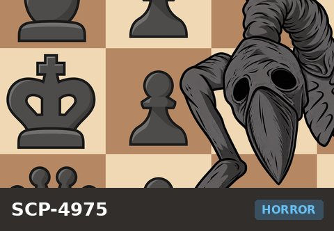</a>
  <a href="https://csardas223.github.io/ChessMaster/play/shotgun-king/">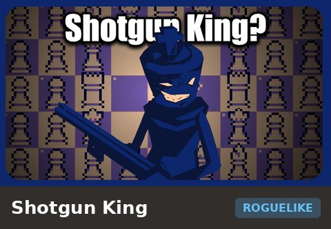</a>
  <a href="https://csardas223.github.io/ChessMaster/play/fps-chess/">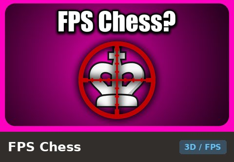</a>
  <a href="https://csardas223.github.io/ChessMaster/play/battle-chess/">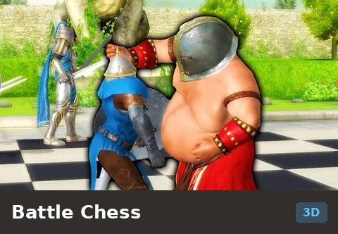</a>
  <a href="https://csardas223.github.io/ChessMaster/play/gun-king/">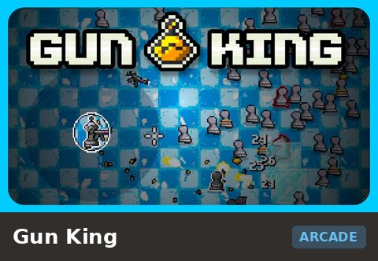</a>
  <a href="https://csardas223.github.io/ChessMaster/play/5d-chess/">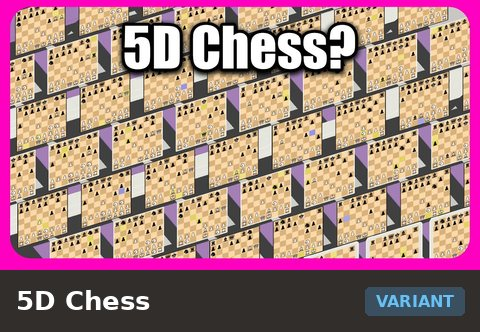</a>
  <a href="https://csardas223.github.io/ChessMaster/play/once-a-pawn-a-king/">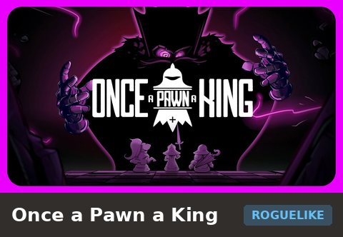</a>
  <a href="https://csardas223.github.io/ChessMaster/play/chess-survivors/">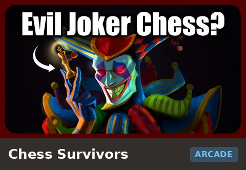</a>
  <a href="https://csardas223.github.io/ChessMaster/play/portal-chess/">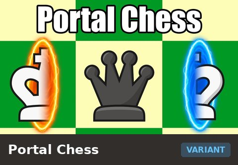</a>
  <a href="https://csardas223.github.io/ChessMaster/play/kung-fu-chess/">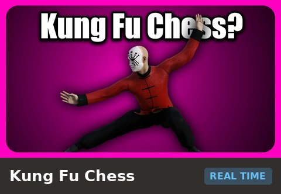</a>
  <a href="https://csardas223.github.io/ChessMaster/play/petrified-pawns/">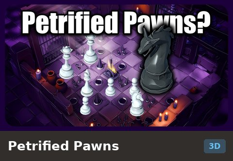</a>
  <a href="https://csardas223.github.io/ChessMaster/play/4-player-team-chess/">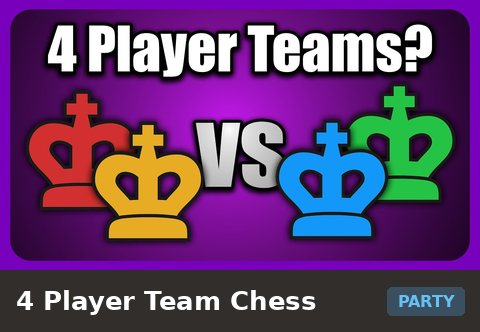</a>
</p>

<p align="center"><b><a href="https://csardas223.github.io/ChessMaster/">Browse all 500+ modes in the lobby</a></b></p>

<details>
<summary><b>All categories</b></summary>

| Category | Modes |
| --- | ---: |
| Variants & Games | 215 |
| Challenges & Odds | 102 |
| Other Videos | 52 |
| Drawback Chess | 38 |
| Variant Bots | 30 |
| Powerups & Rule Twists | 29 |
| Horror Chess | 23 |
| Dice Chess | 15 |
| Other (Real-time, Meme, Play Stockfish) | 3 |

Most modes run on the shared board engine; the full games (roguelikes, Gun King, 5D, Infinite Craft and more) run in
their own canvas. Counts from `data/modes/index.js`.
</details>

## System requirements

<table>
  <tr><th align="left">&nbsp;</th><th align="left">Minimum</th><th align="left">Recommended</th></tr>
  <tr><td><b>Device</b></td><td>Any phone, tablet or computer</td><td>A phone from the last ~5 years, or any desktop</td></tr>
  <tr><td><b>Browser</b></td><td>Chrome, Edge, Firefox or Safari with WebAssembly</td><td>Latest Chrome, Edge, Firefox or Safari</td></tr>
  <tr><td><b>Graphics</b></td><td>Any (2D modes)</td><td>WebGL for the 3D and FPS modes</td></tr>
  <tr><td><b>Network</b></td><td>Online on first open of a mode</td><td>Broadband for the 3D modes</td></tr>
  <tr><td><b>Storage</b></td><td>None, nothing to install</td><td>None</td></tr>
  <tr><td><b>Input</b></td><td>Touch or mouse</td><td>Keyboard + mouse for FPS Chess</td></tr>
</table>

If an engine can't load, the bot falls back to the built-in search and the game stays playable.
Share any mode with its own link, e.g. [`play/scp-4975/`](https://csardas223.github.io/ChessMaster/play/scp-4975/).

---

<details>
<summary><b>Controls</b></summary>

| Input | Action |
| --- | --- |
| Tap / click a piece, then a highlighted square | Move |
| Drag a piece | Move; slingshot, launch and portal modes read the drag direction and distance |
| Tap a selected piece again | The mode's extra action, where it has one |
| Right-click a square | Mark it (again to clear) |
| Tab, then arrow keys | Keyboard board cursor; Enter / Space selects or moves, Esc leaves the board |
| Action bar | Options, New, Flip, Undo, Resign, Lobby |
</details>

<details>
<summary><b>For developers</b></summary>

Static site, no build step, no backend. Node.js 20.19+ / 22.13+ / 24+ for the checks only.

```sh
git clone https://github.com/csardas223/ChessMaster.git && cd ChessMaster
npm run serve       # python3 -m http.server 8000, then open http://localhost:8000/
npm ci              # pinned lint/test tooling
npm test            # engine rules tests
npm run lint        # ESLint over js/, qa/, test/, tools/
npm run validate    # every mode file + the generated lobby index
npm run sweep       # builds every mode in a Node sandbox
```

Modes live in `data/modes/<youtubeId>.js` (format: [docs/ARCHITECTURE.md](docs/ARCHITECTURE.md)), their art in
`assets/modes/<youtubeId>/`. Run `node tools/build-data.mjs` after adding or removing a mode (it also writes the
share pages in `play/`). Browser checks: `python3 tools/qa_ui.py`, `python3 tools/qa_motion.py`.
README media (`docs/media/`): `python3 tools/readme_art.py` (key art, buttons, tags, tiles, cards),
`python3 tools/readme_clips.py` (board-mode clips), `python3 tools/readme_media.py fps|battle|gunking` +
`python3 tools/readme_compose.py` (3D / canvas clips). More: [docs/MODULES.md](docs/MODULES.md),
[docs/AI.md](docs/AI.md), [STATUS.md](STATUS.md), [CONTRIBUTING.md](CONTRIBUTING.md), [HANDOFF.md](HANDOFF.md).
</details>

<sub><b>Credits.</b> Videos, mode concepts, the iwantcheckmate name and logo, and the mode art and thumbnails taken
from the videos and the site belong to <a href="https://www.youtube.com/@iwantcheckmate">iwantcheckmate</a>. Go watch
the videos. Engines: Stockfish, Maia, Fairy-Stockfish (GPLv3). Piece sets via lichess and others, Lucide icons (ISC),
three.js (MIT), sounds from CC0 sources and our own synthesis. Full list: <a href="LICENSES.md">LICENSES.md</a>.<br>
<b>Licence.</b> The project's own code is <a href="LICENSE">Apache-2.0</a> (<a href="NOTICE">NOTICE</a>). Third-party
assets keep their own licences, and the Apache licence grants no rights to iwantcheckmate's material. Unofficial,
non-commercial fan project.</sub>

<p align="center"><a href="https://www.youtube.com/@iwantcheckmate"></a><br><sub>Made with love for <a href="https://www.youtube.com/@iwantcheckmate">iwantcheckmate</a>. Watch the videos.</sub></p>
